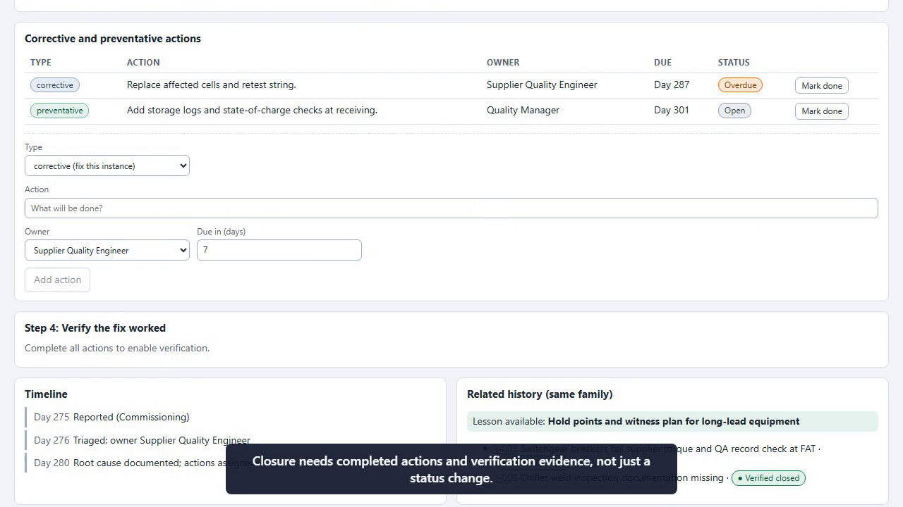
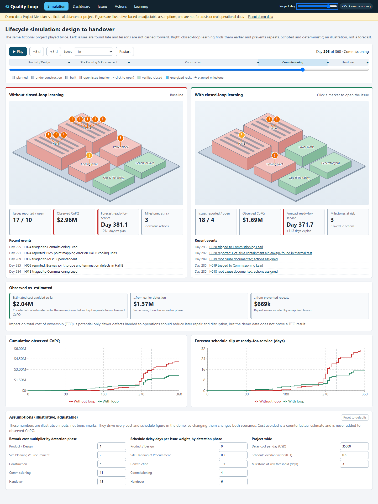

# Quality Loop for Data-Center Delivery

[](docs/media/quality-loop-demo.mp4)

**[▶ Watch the demo video](docs/media/quality-loop-demo.mp4)** (about 90 seconds, captioned and narrated) · **[Live demo](https://dadcoder001.github.io/datacenter-quality-loop/)** · [Video on the live site](https://dadcoder001.github.io/datacenter-quality-loop/#/video) · Reusable skill: in the works

A closed-loop quality and learning MVP for data-center delivery, from product design through site work, construction, commissioning and facility handover. It is company-neutral and uses a fictional project ("Project Meridian") with clearly labeled demo data.



## Why this exists

Data centers are the picks and shovels of the AI economy. Models and chips get the attention, but none of it runs until capacity is built, and built right. With that much capital going into steel, power and cooling, the economics of quality get interesting: a defect caught in design costs a fraction of the same defect found at commissioning, and every week of delay is capacity that isn't earning.

I have no professional background in data-center delivery. This is a weekend of curiosity, built with AI tools (GitHub Copilot) as a pair, to explore one question: what would a closed loop of capture, root cause, verification and lessons learned look like here, and what could it be worth?

Treat it as a thinking tool, not an authority:

- All data is fictional and every assumption is editable.
- It is not a forecast, a benchmark or a claim about any real project or company.
- **Practitioner feedback is the point.** If you work in data-center design, construction, commissioning or quality, please [open an issue](../../issues/new?template=practitioner-feedback.md) and tell me where it matches reality and where it misses.

## What it shows

- **Lifecycle simulation**: the same project played twice, closed loop OFF vs ON, on an isometric site view with a project-day scrubber (day 0–360, five phases, five capacity milestones).
- **Closed loop workflow**: capture, triage, 5-Whys root cause, corrective and preventative actions, verification with evidence, lesson learned.
- **Dashboard**: open and overdue issues, time to triage and closure, repeat-issue rate, milestones at risk, cost of poor quality (CoPQ) by detection phase.
- **Learning view**: lessons that prevent repeat issues in later phases.
- **Editable assumptions**: cost multipliers by detection phase, delay cost, schedule overlap.

## Run it

```powershell
npm install
npm run dev                      # development
npm run build; npm run preview   # production build on http://localhost:4173
```

## Verify it

```powershell
npm run lint; npm run typecheck; npm test; npm run build; npm run neutrality
npx playwright install chromium  # first time only
npm run e2e                      # workflows and accessibility (axe)
```

## Demo assets

- Screenshots: `docs/screenshots/` (`node scripts/screenshots.mjs` against a running preview).
- Video: `docs/media/quality-loop-demo.mp4` (also a release asset). Regenerate with `node scripts/record-demo.mjs` against a running preview, then copy from `demo-output/`. Outline in [docs/video-script.md](docs/video-script.md).

## Honesty notes

- All data is fictional and scripted; the simulation is deterministic (no randomness).
- **Observed CoPQ** (recorded rework, materials, retest, delay) is kept separate from **estimated avoided cost** (a counterfactual from assumptions). TCO benefit is potential, not claimed.
- Definitions: [docs/metrics.md](docs/metrics.md). Defaults and rationale: [docs/assumptions.md](docs/assumptions.md).

## 3D option

The renderer sits behind a `SceneRenderer` interface and facility geometry is plain data (`src/render/scene.ts`), so a 3D renderer can replace the isometric one without touching the engine or UI.

## What's next

I'm working on turning this into a reusable skill that can be adapted to your own data-center business (your phases, issue families, cost drivers and terminology). It is not available yet.

## License

MIT, see [LICENSE](LICENSE).

## Practitioner review checklist

Please challenge: phase names and handover gates; the root-cause flow; cost categories and multipliers; whether the seed issue families match real data-center delivery defects.
